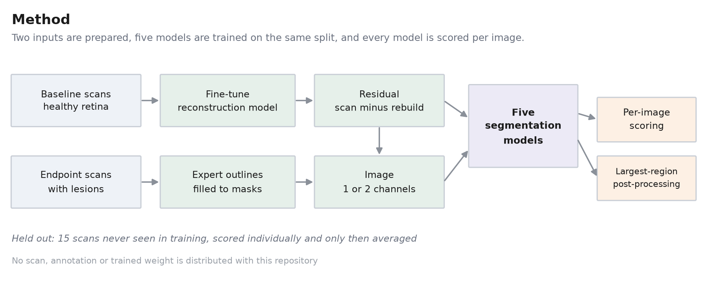
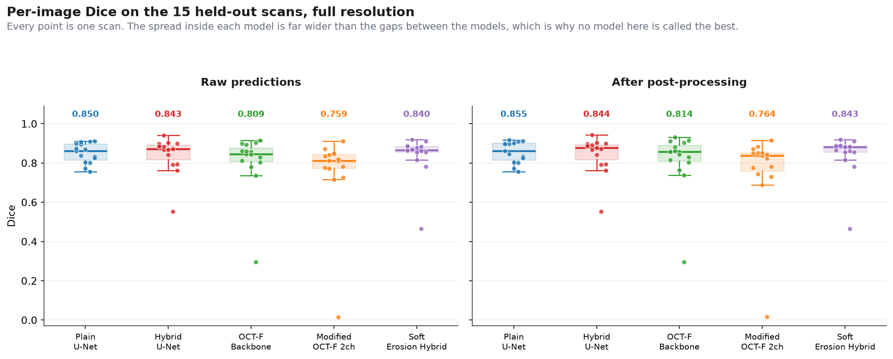

# Retinal Lesion Segmentation in OCT

Finding laser-induced lesions in retinal OCT B-scans, automatically.


In preclinical retinal research these lesions are measured by hand: a scientist outlines each one
on screen, scan by scan. It is slow, and two people outlining the same lesion do not draw the same
boundary. This replaces that step with a segmentation model, and treats the choice of model as a
question to be answered rather than assumed.

**0.850 Dice on held-out scans.** The more useful result is that two ideas expected to beat it did
not, and the measurements showing why are in here.



A reconstruction model is fine-tuned on healthy baseline scans, so the difference between a
lesioned scan and its reconstruction becomes a map of where the retina departs from normal. That
residual is offered to the models as a second input channel. Five models then train on the same
split and are scored on the same 15 held-out scans.

## Results

Full resolution, 496 x 768, on 15 held-out scans.

| Model | Inputs | Parameters | Dice | Precision | Recall | Fragmented |
|---|---|---|---:|---:|---:|---:|
| Plain U-Net | image | 7.77 M | **0.850** | 0.840 | 0.874 | 5 / 15 |
| Hybrid U-Net | image + residual | 7.77 M | 0.843 | **0.892** | 0.820 | 2 / 15 |
| Soft Erosion Hybrid | image + residual | 7.77 M | 0.840 | 0.880 | 0.832 | 3 / 15 |
| OCT-F Backbone | image | 1.98 M | 0.809 | 0.837 | 0.824 | 4 / 15 |
| Modified OCT-F 2ch | image + residual | 1.98 M | 0.759 | 0.854 | 0.741 | 10 / 15 |



**No model here is the best.** Each dot is one scan. The spread within any model is wider than the
gap between models. With 15 validation images the standard error is about 0.013, so anything closer
than roughly 0.026 cannot be told apart, and almost every gap in that table is smaller than that.

**The residual moves error around rather than removing it.** Precision climbs from 0.840 to 0.892,
recall drops from 0.874 to 0.820, overlap barely changes.

**The pretrained encoder is the practical win.** 0.809 Dice with a quarter of the parameters.

## Try it

```
pip install -r requirements.txt
python code/verify_numbers.py
```

No data, no GPU, no download. It recomputes every number above from the stored per-image scores and
checks each one. Every figure quoted here comes out of that script.

Run a model on your own image with `python demo/demo.py --image yourscan.png`.

## What is in here

```
code/          the five networks, losses, training, scoring, verification
notebooks/     the analysis, 02 to 05
gpu_notebooks/ the three training runs
demo/          run a trained model on a scan
results/       per-image scores and the canonical numbers
docs/METHOD.md the long version: design decisions, and running this on your own data
```

## Honest limits

The imaging data used in this study is private, so no scan, annotation or trained weight is
included here. OCT-F, the reconstruction model by Haider et al., is withheld until its authors
publish; the segmentation networks take the pretrained encoder as an argument, so `architectures.py`
stands alone.

These weights were fitted to preclinical OCT from one study, annotated by one person. Applied to
anything else, a number from this repository illustrates the method rather than reporting a result.

**No animal procedures were carried out for this project.** The scans predate it, collected under
the regulatory framework governing animal research. This is research code, not a diagnostic device.

## Credits

MSc Artificial Intelligence dissertation, Queen's University Belfast, with an industry partner in
preclinical retinal disease who provided the imaging data and expert annotations. Supervised by
**Dr Richard Gault**. Author: **Ramdas Narayan Chaugale**.

OCT-F is the work of Haider et al. at the School of EEECS, used with permission:
[Combining self-attention and convolution to understand OCT images](https://research.tees.ac.uk/en/publications/combining-self-attention-and-convolution-to-understand-oct-images/),
IMVIP 2025. Closest prior work in the group is Baine et al., IMVIP 2025. Training ran on Kelvin2,
provided by the Northern Ireland High Performance Computing service.

MIT licence, see [LICENSE](LICENSE). It covers the code only, not the private imaging data or OCT-F.
