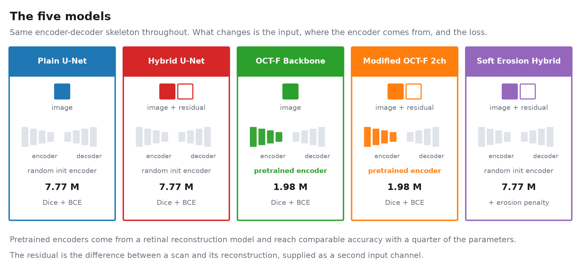
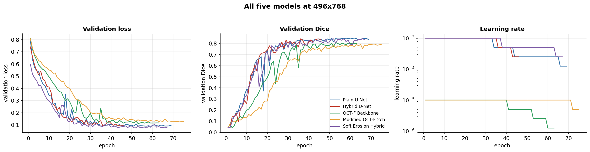

# Method and detail

The README is deliberately short. This is the long version: the problem, the
five model variants, what the comparison actually showed, and how to run the
code on a different dataset.

## Introduction

Optical coherence tomography produces cross-sectional images of the retina, and in preclinical
research it is used to track how a retinal injury develops over time. A common experimental model
induces small, controlled lesions with a laser, then images the same eyes at intervals to measure
how each lesion changes.

Measuring them is the slow part. A scientist opens each scan and outlines every lesion by hand, one
at a time. The work is repetitive, it takes hours, and two people outlining the same lesion will
not produce the same boundary. That variability matters: it widens the spread of the
measurements, which means a study needs more animals to detect the same effect.

This project replaces that manual step with a segmentation model that outlines the lesions
automatically. Rather than picking one model and assuming it is the right one, five designs are
compared under the same conditions: a standard U-Net, a version that also
receives a reconstruction residual as a second input, two built on a pretrained retinal foundation
model at a quarter of the parameters, and one trained with a connectivity penalty in its loss.

The honest answer is that the differences between most of them are smaller than the noise, and
this repository says so and shows the working. Two of the ideas that were expected to help did not,
and both are reported with the measurements that show why.

## The five models



The skeleton is the same throughout, an encoder-decoder segmentation network. Three things vary:
whether the input is the image alone or the image plus its residual, whether the encoder is
randomly initialised or taken from the pretrained reconstruction model, and whether the loss
includes a connectivity penalty.

## Design decisions

**Face the problem where it is.** A lesion is a local disruption of retinal layers, so the models
are ordinary encoder-decoder segmentation networks rather than anything exotic. Two of the five
reuse a pretrained encoder from a retinal reconstruction model, at a quarter of the parameters.

**The residual idea.** A reconstruction model trained on healthy-baseline scans should reconstruct
lesioned tissue badly. The difference between the scan and its reconstruction is therefore a map of
where the retina deviates from expectation. Feeding that alongside the image gives the network a
second view of the same tissue. It helps precision and costs recall, which the evaluation quantifies
rather than asserts.

**Connectivity.** A laser lesion is one connected region, so a prediction broken into fragments is
wrong by construction. Two approaches were tried: a differentiable erosion penalty inside the loss,
and morphological post-processing afterwards. Only the second works.

**Scoring.** Dice, IoU, precision, recall, connected-component counts, and the split between missed
lesion and wrongly included tissue, per image rather than averaged early.

## What the results actually say

This is the part most model comparisons leave out.

**No model here is "the best".** There are 15 validation images, so the standard error is about
0.013, and two configurations closer than roughly 0.026 cannot be told apart. Nearly every gap in
the table above is smaller than that. Ranking them would be reading noise.

**One image decides which model appears to win.** On a single held-out scan four of the five models
collapse while the Plain U-Net holds at 0.802. Remove that one image and the leader moves from
first place to third. That is reported here rather than quietly dropped.

**Two results are negative, and that was the point of running them.** Adding a reconstruction
residual as a second input channel does carry a lesion signal, but a weaker one than the image
already carries, so it moves error around instead of removing it. Compare the first two rows of the
table: precision climbs from 0.840 to 0.892 while recall drops from 0.874 to 0.820. Overlap barely
changes, the errors just swap sides. Putting a connectivity penalty inside the loss function does
not work either, while applying the same idea as post-processing after training does.

A negative result that is measured and explained is worth more than a positive one that is not
reproducible.

## Training curves



Per-model curves for each run are in `figures/`.

## Running this on your own data

Nothing here is tied to a particular dataset. The loaders take folder paths and a list of
filenames, so any set of images with matching masks will work.

**What the folders need to look like.** One folder of scans and one folder of masks. A mask is
found by swapping the extension, so `anything.tif` is paired with `anything_mask.png` in the mask
folder. Masks are read greyscale and thresholded at 127, so anything binary will do.

```python
from datasets import SingleChannelDataset, HybridDataset

train = SingleChannelDataset(image_folder, mask_folder, file_list,
                             img_size=(496, 768), augment=True)
```

`img_size` takes an int for a square resize or a `(height, width)` pair to keep native geometry.
The two-channel models use `HybridDataset`, which additionally takes a dict of precomputed
reconstruction residuals keyed by filename; without a reconstruction model, use the one-channel
models, which are the leading configuration anyway.

**What to change for a different image size.** The post-processing kernel is the one setting that
does not scale itself. `improved_post_processing` closes gaps with an elliptical kernel sized 15 at
256 x 256 and 29 at 496 x 768, so scale it roughly with the image and keep it odd.

**Three assumptions worth checking against your own scans.** Images are expected to be greyscale
stored as three identical channels, and a single channel is taken by indexing rather than averaging;
if your channels genuinely differ, that line needs changing. The connectivity post-processing keeps
only the largest connected region, which is right for a single lesion and wrong for anything
multi-focal. And the reported numbers come from 15 validation images, so treat them as an
illustration of the method rather than a benchmark.

**Just want to see a model run?** `demo/demo.py` takes any PNG, JPG or TIF and writes an overlay,
and scores itself if you pass a ground-truth mask.
